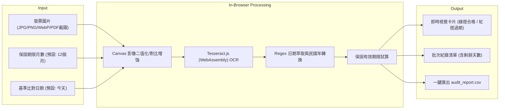
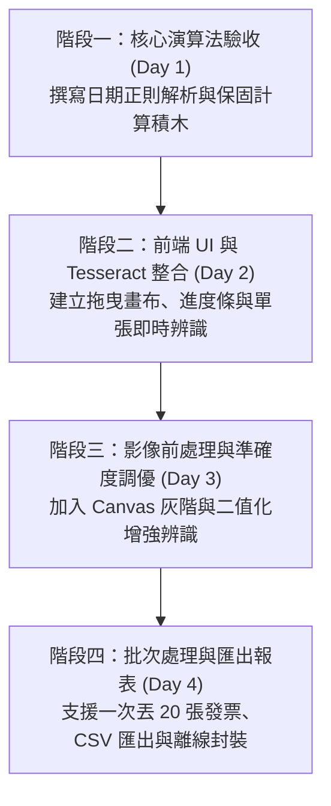

# 統一發票 OCR 保固判定系統：100% 純前端 Web App 開發計劃

> **核心口訣回顧**：  
> **「不背語法想流程，先定輸入與輸出；  
> 大題化小拆積木，指揮 AI 做驗收。」**

本專案借鑑 `d:\code秋季115\miao` 系列專案（行事曆、電影資訊）的無伺服器架構，打造 **零環境安裝依賴（No Python / No Node.js）、純瀏覽器本地離線執行** 的電子發票日期辨識與保固判定工具。

---

## 一、專案目標與核心價值

1. **零安裝、開箱即用**：發送一個資料夾（或單一 HTML），任何 Windows / Mac 電腦雙擊 `index.html` 即可在 Edge / Chrome 立即運行。
2. **極致隱私安全**：發票圖片與個資 100% 停留在本機瀏覽器記憶體中，不發送至任何外部伺服器。
3. **工作增效**：提供發票拖曳上傳、即時影像預處理、自動萃取發票月份/日期、保固倒數紅綠燈警示，以及一鍵匯出 CSV。

---

## 二、心法一：I/O 思維（定義輸入與輸出）



---

## 三、技術選型與關鍵解決方案

| 元件 | 採用技術 | 架構考量與設計 |
| :--- | :--- | :--- |
| **結構與佈局** | HTML5 + CSS3 (Flexbox/Grid) | 現代暗色/簡約卡片風格，支援行動端與桌上型螢幕拖曳。 |
| **OCR 核心** | **Tesseract.js v5 (WASM)** | 瀏覽器原生運算；支援內嵌繁中（`chi_tra`）與英文數字訓練模型快取。 |
| **影像預處理** | **HTML5 Canvas API** | 提升瀏覽器 OCR 準確率的關鍵：自動轉灰階、高對比度閥值濾鏡（Thresholding）。 |
| **離線快取** | Cache Storage / IndexedDB | 首次載入模型後自動離線快取，第二次離線斷網亦可全速運行。 |
| **資料持久化** | `localStorage` | 儲存歷史辨識紀錄與自訂保固規則設定。 |

---

## 四、心法三：切分 5 顆 Lego 積木（模組化架構）

```
專案目錄結構規劃
invoice-warranty-app/
├── index.html              # 網頁骨架與拖曳區域
├── css/
│   └── style.css           # 現代化 UI 主題（綠/紅燈狀態標籤）
├── js/
│   ├── [積木 1] image_preprocessor.js # Canvas 影像優化（去噪/銳化）
│   ├── [積木 2] ocr_engine.js         # Tesseract.js Worker 封裝
│   ├── [積木 3] date_extractor.js     # 發票格式與正則解析（民國/西元）
│   ├── [積木 4] warranty_logic.js     # 保固計算決策核心
│   └── [積木 5] app.js                # DOM 事件綁定與 CSV 匯出調度
└── vendor/
    └── tesseract.min.js    # 本地備援 WASM 核心（確保純離線可用）
```

### 積木功能職責說明：

1. **[積木 1] 影像預處理 (`image_preprocessor.js`)**：
   - 發票常見問題是皺摺與光線不足。透過 Canvas 將圖片自動轉為灰階、拉高對比度，讓 Tesseract 辨識率提升 30% 以上。
2. **[積木 2] OCR 封裝 (`ocr_engine.js`)**：
   - 建立 Web Worker 非同步辨識，避免畫面卡頓；回傳進度百分比（Progress Bar）。
3. **[積木 3] 發票解析引擎 (`date_extractor.js`)**：
   - 處理發票常見樣式：
     - 樣式 A：`113年09-10月`（期別月）
     - 樣式 B：`113-10-15` 或 `2024-10-15`（開立日期）
     - 樣式 C：發票號碼格式（兩位英文字母 + 8 位數字，如 `AB-12345678`）。
4. **[積木 4] 保固決策核心 (`warranty_logic.js`)**：
   - 純純粹的業務邏輯：傳入發票日期、保固月數、基準日，計算到期日、剩餘天數與布林值判定。
5. **[積木 5] 主調度器 (`app.js`)**：
   - 監聽拖曳放下（Drag & Drop）、點擊上傳、渲染表格與一鍵匯出 CSV。

---

## 五、分階段實施路線圖（里程碑）



### 階段一：核心解析積木原型（零 UI 驗收）
- 定義好正則表達式，準備 5 種典型台灣發票文字樣本進行單元測試（Unit Test）。

### 階段二：單頁介面與 OCR 串接
- 完成 `index.html` 基礎佈局，放入拖曳上傳區塊。
- 引入 Tesseract.js，驗證上傳一張照片能在 Console 印出文字。

### 階段三：準確率調優（關鍵突破點）
- 針對 Tesseract.js 繁體中文發票的辨識短板，加入「影像自動裁剪與對比強化」演算法。
- 提供「人工修正微調框」：若 OCR 辨識日期信心度不足，允許人工在畫面點選微調。

### 階段四：批次化與產品化包裝
- 支援多檔同時拖曳（Batch Processing）。
- 匯出符合會計/稽核格式的 Excel 相容 CSV。
- 將靜態檔案壓縮成 `發票保固小工具.zip`，達成即解即用。

---

## 六、架構師驗收清單（Checklist）

- [ ] **斷網可用性**：拔除網路線後重新整理頁面，OCR 模型是否能從快取正常載入？
- [ ] **跨平台支援**：Chrome、Edge 及手機版瀏覽器是否均能正常拍攝或選取圖片？
- [ ] **極端值容錯**：
  - 上傳非發票圖片（如純風景照）是否會優雅提示「未偵測到發票號碼」？
  - 民國年是否能正確轉換為西元年（如 113年 ➔ 2024年）？
- [ ] **大圖記憶體管理**：批次上傳多張手機高畫質照片時，是否即時釋放 Canvas 記憶體（避免網頁崩潰崩潰）？

