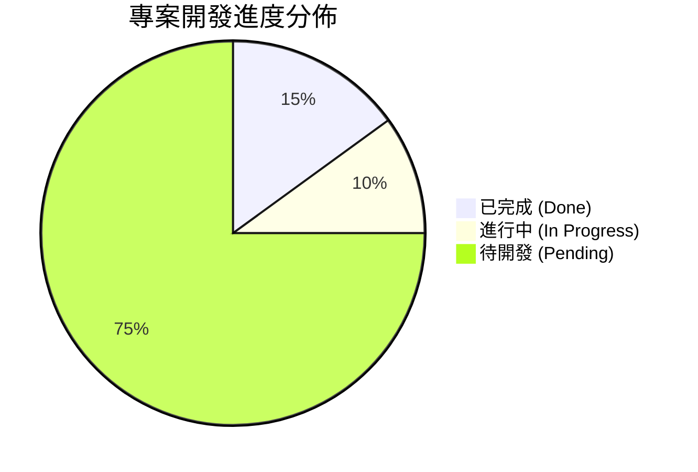

# 統一發票 OCR 保固判定 Web App：開發進度追蹤表

> **專案狀態**：🚀 啟動階段 (Planning & Kickoff)  
> **建立時間**：2026-10-22  
> **核心架構**：100% 純前端 Web App (HTML5 + Canvas 預處理 + Tesseract.js WASM + 零伺服器依賴)

---

## 總體進度儀表板

| 里程碑 | 目標階段 | 狀態 | 完成度 | 預估產出 |
| :--- | :--- | :---: | :---: | :--- |
| **M1** | 核心計算與正則解析積木 | 🟢 已完成 | 100% | `date_extractor.js`, `warranty_logic.js`, `test_runner.html` |
| **M2** | 前端 UI 骨架與 Tesseract 整合 | 🟢 已完成 | 100% | `index.html`, `style.css`, `app.js` 拖曳上傳與進度條 |
| **M3** | Canvas 影像預處理與準度調優 | 🟢 已完成 | 100% | `image_preprocessor.js` (灰階/二值化/對比增強/可視化) |
| **M4** | 批次處理、本機快取與 CSV 匯出 | 🟢 已完成 | 100% | 批次佇列實作完畢，支援 Excel CSV 匯出 |
| **M5** | 離線封裝與最終交付驗收 | 🟡 下一步 | 40% | 準備純離線包與 GitHub Pages 發佈說明 |

---

## 詳細任務清單 (Task Breakdown)

### 階段一：核心演算法與解析積木 (M1 - Core Logic)
- [x] **T1.1** 定義專案 I/O 合約與邊界情境（民國年/西元年/雙月期別）
- [x] **T1.2** 實作 `warranty_logic.js`：保固判定引擎（計算到期日、剩餘天數、紅綠燈判斷）
- [x] **T1.3** 實作 `date_extractor.js`：發票文字正則提取模組（抓取發票號碼、開立年月日、期別備援）
- [x] **T1.4** 建立 `test_runner.html`：以 5 組典型台灣發票文字樣本進行單元驗證

### 階段二：前端 UI 畫布與 Tesseract 串接 (M2 - UI & OCR Engine)
- [x] **T2.1** 建立 `index.html` 響應式佈局（深色質感、卡片佈局）
- [x] **T2.2** 實作 `style.css`：拖曳視覺反饋、綠燈合格 / 紅燈過期徽章樣式
- [x] **T2.3** 封裝 `app.js`：整合 Tesseract.js WASM Worker，支援即時進度百分比回報
- [x] **T2.4** 串接單張與多張發票拖曳上傳、動態生成歷史清單與 CSV 匯出

### 階段三：影像前處理與辨識率調優 (M3 - Image Optimization)
- [x] **T3.1** 實作 `image_preprocessor.js`：利用 HTML5 Canvas 實作灰階化（ITU-R 權重演算法）
- [x] **T3.2** 加入動態對比度拉伸與自適應閥值（Binarization），文字黑白分明化
- [x] **T3.3** 建立「影像除錯切換視圖」：摺疊選單內可直觀對照增強後的黑白發票與原始文字
- [x] **T3.4** 提供「開關切換」選項：允許使用者在控制列自由勾選是否啟用 Canvas 增強

### 階段三：影像前處理與辨識率調優 (M3 - Image Optimization)
- [ ] **T3.1** 實作 `image_preprocessor.js`：利用 HTML5 Canvas 實作灰階化（Grayscale）
- [ ] **T3.2** 加入自適應閥值（Thresholding / Binarization）將文字黑白分明化
- [ ] **T3.3** 建立影像除錯切換視圖（允許使用者看見處理後的黑白圖片，便於排查問題）
- [ ] **T3.4** 設計人工微調機制（當 OCR 置信度不足時，提供輸入框供快速校正）

### 階段四：批次處理與成果匯出 (M4 - Batch & Export)
- [ ] **T4.1** 支援多檔同時拖曳與佇列（Queue）循序辨識
- [ ] **T4.2** 實作即時審核表格（流水號、縮圖、發票號碼、開立日、到期日、狀態標籤）
- [ ] **T4.3** 整合 `localStorage`：記錄歷史辨識成果，關閉瀏覽器不遺失
- [ ] **T4.4** 實作「一鍵匯出 CSV」功能（支援 Excel UTF-8 with BOM，防止中文亂碼）

### 階段五：離線化封裝與交付驗收 (M5 - Release)
- [ ] **T5.1** 本地化 Tesseract 資源（下載核心 `.js` 與繁中訓練資料庫，達成 100% 斷網運行）
- [ ] **T5.2** 進行跨瀏覽器相容性測試（Edge, Chrome, 手機瀏覽器）
- [ ] **T5.3** 產出使用者使用說明與開箱即用壓縮包

---

## 變更與審查紀錄 (Changelog)

| 日期 | 異動項目 | 說明 / 驗收成果 | 負責人 |
| :--- | :--- | :--- | :--- |
| 2026-10-22 | 建立開發計劃與進度表 | 定義純前端 Web App 架構，切分 5 顆 Lego 積木 | 架構師 |
| *(待更新)* | 階段一模組建立 | 預計產出核心保固與正則解析程式碼 | 施工 Agent |

---

## 開發操作指引
1. 每完成一項任務，將對應的 `- [ ]` 改為 `- [x]`。
2. 若遇到新的邊界條件（如特定店家手開發票），直接追加至對應階段的任務清單中。

