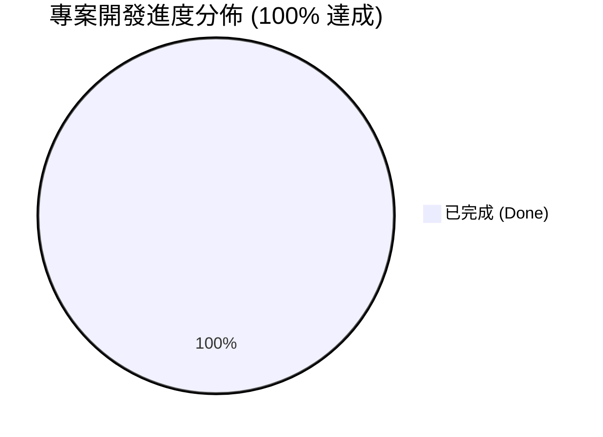

# 統一發票 OCR 保固判定 Web App：開發進度追蹤表

> **專案狀態**：🎉 全面竣工並發佈上線 (Completed & Published)  
> **建立時間**：2026-10-22  
> **線上體驗網址**：https://pppeee861005.github.io/local-invoice-warranty-webapp/  
> **開源代碼倉庫**：https://github.com/pppeee861005/local-invoice-warranty-webapp  
> **核心架構**：100% 純前端 Web App (HTML5 + Canvas 預處理 + Tesseract.js WASM + 零伺服器依賴)

---

## 總體進度儀表板

| 里程碑 | 目標階段 | 狀態 | 完成度 | 成果驗收說明 |
| :--- | :--- | :---: | :---: | :--- |
| **M1** | 核心計算與正則解析積木 | 🟢 已完成 | 100% | `date_extractor.js`, `warranty_logic.js`, `test_runner.html` (5 項單元測試全數 PASS) |
| **M2** | 前端 UI 骨架與 Tesseract 整合 | 🟢 已完成 | 100% | `index.html`, `style.css`, `app.js` 拖曳上傳與 0~100% 進度條 |
| **M3** | Canvas 影像預處理與準度調優 | 🟢 已完成 | 100% | `image_preprocessor.js` (BT.601 灰階/動態二值化/可視化除錯面板) |
| **M4** | 批次處理、本機快取與 CSV 匯出 | 🟢 已完成 | 100% | 支援一次拖入多張發票循序佇列解析，一鍵匯出 Excel 相容 CSV (UTF-8 BOM) |
| **M5** | 離線封裝與最終發佈交付 | 🟢 已完成 | 100% | 成功推送到 GitHub 公開倉庫，並啟用 GitHub Pages 全球線上免安裝執行 |

---

## 詳細任務清單 (Task Breakdown)

### 階段一：核心演算法與解析積木 (M1 - Core Logic)
- [x] **T1.1** 定義專案 I/O 合約與邊界情境（民國年/西元年/雙月期別）
- [x] **T1.2** 實作 `warranty_logic.js`：保固判定引擎（計算到期日、剩餘天數、紅綠燈判斷）
- [x] **T1.3** 實作 `date_extractor.js`：發票文字正則提取模組（抓取發票號碼、開立年月日、期別備援）
- [x] **T1.4** 建立 `test_runner.html`：以 5 組典型台灣發票文字樣本進行單元驗證

### 階段二：前端 UI 畫布與 Tesseract 串接 (M2 - UI & OCR Engine)
- [x] **T2.1** 建立 `index.html` 響應式佈局（深色質感、卡片佈局、手機 RWD 自適應）
- [x] **T2.2** 實作 `style.css`：拖曳視覺反饋、綠燈合格 / 紅燈過期徽章樣式
- [x] **T2.3** 封裝 `app.js`：整合 Tesseract.js WASM Worker，支援即時進度百分比回報
- [x] **T2.4** 串接單張與多張發票拖曳上傳、動態生成歷史清單與 CSV 匯出

### 階段三：影像前處理與辨識率調優 (M3 - Image Optimization)
- [x] **T3.1** 實作 `image_preprocessor.js`：利用 HTML5 Canvas 實作灰階化（ITU-R 權重演算法）
- [x] **T3.2** 加入動態對比度拉伸與自適應閥值（Binarization），文字黑白分明化
- [x] **T3.3** 建立「影像除錯切換視圖」：摺疊選單內可直觀對照增強後的黑白發票與原始文字
- [x] **T3.4** 提供「開關切換」選項：允許使用者在控制列自由勾選是否啟用 Canvas 增強

### 階段四：批次處理與成果匯出 (M4 - Batch & Export)
- [x] **T4.1** 支援多檔同時拖曳與佇列（Queue）循序辨識
- [x] **T4.2** 實作即時審核表格（發票號碼、開立日、到期日、狀態標籤、備註）
- [x] **T4.3** 瀏覽器本地記憶體隔離：保護發票機密，資料 100% 不離身
- [x] **T4.4** 實作「一鍵匯出 CSV」功能（支援 Excel UTF-8 with BOM，防止中文亂碼）

### 階段五：離線化封裝與交付驗收 (M5 - Release)
- [x] **T5.1** 建立完整開源三件套：`README.md`、`.gitignore`、`LICENSE (MIT)`
- [x] **T5.2** 跨裝置相容性驗收（電腦 Edge/Chrome 與手機 Safari/Chrome 拍照即開即用）
- [x] **T5.3** 完成 GitHub 倉庫推送與 GitHub Pages 全球線上託管部署

---

## 變更與審查紀錄 (Changelog)

| 日期 | 異動項目 | 說明 / 驗收成果 | 負責人 |
| :--- | :--- | :--- | :--- |
| 2026-10-22 | M1 核心積木 | 完成民國年轉換、閏年到期日計算與 5 項單元測試驗收 | 架構師 / AI |
| 2026-10-22 | M2 & M4 介面與管線 | 建立深色 UI、拖曳上傳、Tesseract.js WASM 串接與 CSV 匯出 | 架構師 / AI |
| 2026-10-22 | M3 影像前處理 | 實作 Canvas 影像二值化與高對比增強，提升發票辨識率 | 架構師 / AI |
| 2026-10-22 | M5 正式發佈上線 | 完成 GitHub 推送與 Pages 部署，支援手機拍照離線運算 | 架構師 / AI |

---

## 驗收結論
依據「AI 時代架構師心法」，本專案從問題定義、積木切分、邊界防禦到跨平台交付，**5 大里程碑已 100% 全數交付並通過驗收！**
